# ESP32 Remote Wake Gateway

A low-cost ESP32-based Wake-on-LAN gateway for remotely starting a computer without keeping a general-purpose server running around the clock.

The ESP32 receives commands through an outbound MQTT-over-TLS connection, generates Wake-on-LAN magic packets on the local network, and publishes structured status events.

The project focuses on **observability** and improving reliability: distinguishing command reception, local packet transmission, and subsequent target-service reachability.

## Project status

This project is under active development.

The current firmware is a prototype intended for personal and lab use.
It is not a high-availability system, and production readiness has not yet been established.

Reliability is an engineering goal, not a measured guarantee.

## Why this project exists

The project started with two practical constraints:

1. The home internet connection was behind carrier-grade NAT (CGNAT), making conventional inbound IPv4 port forwarding unsuitable.
2. Keeping a gaming PC powered on continuously just to remain remotely accessible was not desirable because of its electricity consumption.

The solution separates the always-on control device from the computer that performs the actual workloads:

- The ESP32 remains powered and connected to the network.
- The target computer can remain shut down when it is not needed.
- A remote MQTT command instructs the ESP32 to send a local Wake-on-LAN packet.
- After startup, the computer can be accessed through a separate remote-access solution.

### Why MQTT helps with CGNAT

CGNAT is typically operated by the internet service provider.
It allows multiple subscribers to share public IPv4 addresses.

Devices in the home network still have private IP addresses.
The constraint is that the home connection may not have a dedicated, directly reachable public IPv4 address.

Instead of requiring an incoming connection to the home network, the ESP32 initiates an outbound connection to a reachable MQTT broker.
The broker forwards commands over that existing connection.

This architecture does not require:

- A dedicated public IPv4 address at home
- Inbound router port forwarding for the wake command
- A VPN client running on the ESP32
- The target computer to remain powered on

The network must still permit the required outbound DNS and MQTT-over-TLS traffic.

## How it works

```mermaid
flowchart LR
    subgraph REMOTE["Remote device"]
        CLIENT["Laptop / Smartphone<br/>MQTT client"]
    end

    subgraph CLOUD["Reachable MQTT service"]
        BROKER["MQTT broker<br/>Example: EMQX Cloud<br/>or another compatible broker"]
    end

    subgraph HOME["Home network"]
        ESP["ESP32 Wake Gateway<br/>Always-on · Wi-Fi<br/>Independent power supply"]
        SERVER["Target computer<br/>Ethernet connection<br/>Wake-on-LAN enabled"]
    end

    CLIENT -->|"Publish wake command<br/>MQTT over TLS"| BROKER
    BROKER -->|"Deliver subscribed command"| ESP

    ESP -->|"Local UDP broadcast<br/>102-byte magic packet"| SERVER
    ESP -.->|"Check configured TCP service<br/>after wake"| SERVER

    ESP -->|"Publish status and logs"| BROKER
    BROKER -->|"Deliver subscribed feedback"| CLIENT

    CLIENT -.->|"Optional remote access<br/>e.g. Tailscale, after startup"| SERVER

    classDef device fill:#6699ee,stroke:#365e9d,stroke-width:2px,color:#10213b;
    classDef broker fill:#ffa34d,stroke:#b86516,stroke-width:2px,color:#33200e;

    class CLIENT,ESP,SERVER device;
    class BROKER broker;

    style REMOTE fill:#eaf2ff,stroke:#6699ee,stroke-width:2px,color:#10213b
    style CLOUD fill:#fff0de,stroke:#ffa34d,stroke-width:2px,color:#33200e
    style HOME fill:#fff4af,stroke:#c7a900,stroke-width:2px,color:#332d0b

    linkStyle 0,1 stroke:#b86516,stroke-width:2px;
    linkStyle 2 stroke:#365e9d,stroke-width:3px;
    linkStyle 3 stroke:#62748c,stroke-width:2px;
    linkStyle 4,5 stroke:#228453,stroke-width:2px;
    linkStyle 6 stroke:#8250c4,stroke-width:2px;
```



### Broker independence

EMQX Cloud is the reference broker used for this project, not a required dependency.

Another reachable MQTT broker can be used if it supports:

- The MQTT protocol version used by the firmware
- MQTT over TLS
- Compatible authentication
- The required publish and subscribe permissions

Provider-specific authentication mechanisms may require firmware changes.

The broker must remain available while the target computer is shut down.
Hosting the only broker on the computer being woken would create a circular dependency.

### Remote access after startup

Tailscale is optional and separate from the wake-command path.

When both MQTT clients can reach the broker, waking the computer does not require a VPN connection.

After startup, Tailscale or another remote-access solution can provide access to the target computer.
Sending a wake command does not itself establish a remote desktop or SSH session.

### Network boundaries

- The ESP32 sends the magic packet within the target computer's local broadcast domain.
- The ESP32 remains independently powered while the target computer is shut down.
- The router, Wi-Fi access point or repeater, internet connection, and MQTT broker must remain available.
- A repeater or access point must allow the required communication between the ESP32 and the target computer.
- Internal virtual machines, VLANs, and unrelated firewall experiments are outside the scope of this project.

## Why status feedback matters

Remote Wake-on-LAN can fail at different stages:

- The remote client cannot connect to the broker.
- The broker does not authorize a publish or subscription.
- The ESP32 loses Wi-Fi or its MQTT connection.
- The ESP32 receives an invalid command.
- The local UDP send operation fails.
- The magic packet does not reach the target network adapter.
- The target's firmware, driver, or power state prevents wake-up.
- The computer starts, but the configured verification service remains unavailable.

The firmware reports separate stages rather than treating packet transmission as proof of a successful startup.

```text
RECEIVED -> SENT -> ONLINE
```

or:

```text
RECEIVED -> SENT -> TIMEOUT
```

## Features

- Remote Wake-on-LAN through MQTT
- TLS certificate validation using a configured root CA
- JSON commands with command IDs
- Limited duplicate-command detection
- Structured JSON status and diagnostic messages
- Repeated magic-packet transmission
- TCP-based target-service reachability checks
- Wi-Fi RSSI, uptime, firmware version, and MQTT state in telemetry
- MQTT Last Will for unexpected connection loss
- Reconnection logic and re-subscription after MQTT reconnect

Availability-topic separation and other reliability improvements must match the firmware version in use.
See the limitations and roadmap below.

## Status interpretation

| Status | Meaning |
|---|---|
| `RECEIVED` | An accepted command reached the ESP32 and passed validation. |
| `SENT` | At least one local UDP send operation succeeded. |
| `ONLINE` | The configured TCP service was reachable during the verification window. |
| `TIMEOUT` | The configured TCP service was not detected before the deadline. |
| `FAILED` | The wake process could not continue, for example because a local send operation failed. |
| `DUPLICATE_COMMAND` | The firmware recognized a duplicate command within its current deduplication scope. |
| `INVALID_PAYLOAD` | The command could not be parsed or failed payload validation. |
| `INVALID_TARGET` | The requested target did not match the configured target. |

`SENT` does not confirm that the target received or processed the magic packet.

`ONLINE` confirms service reachability.
It does not prove that this particular command caused the computer to start; the computer may already have been running.

`TIMEOUT` does not necessarily mean that the computer remained powered off.
The verification service may be stopped, blocked, or slow to start.

## Configuration files

The repository separates public firmware settings from private deployment settings.

```text
esp32_remote_wake_gateway/
├── esp32_remote_wake_gateway.ino
├── config.h
├── secrets.example.h
├── secrets.h
├── .gitignore
├── README.md
└── LICENSE
```

| File | Purpose | Commit to Git? |
|---|---|---|
| `esp32_remote_wake_gateway.ino` | Firmware logic | Yes |
| `config.h` | General firmware settings and timing | Yes |
| `secrets.example.h` | Public template with example values | Yes |
| `secrets.h` | Actual credentials and personal network settings | No |

Copy the template:

```bash
cp secrets.example.h secrets.h
```

Replace the example values in `secrets.h` before building.

### Personal settings

| Variable | Purpose |
|---|---|
| `WIFI_SSID` | Wi-Fi network name |
| `WIFI_PASSWORD` | Wi-Fi password |
| `MQTT_HOST` | Broker hostname |
| `MQTT_PORT` | Broker TLS port |
| `MQTT_CLIENT_ID` | Unique MQTT client identifier |
| `MQTT_USER` | ESP32 MQTT username |
| `MQTT_PASSWORD` | ESP32 MQTT password |
| `COMMAND_TOPIC` | Incoming wake-command topic |
| `AVAILABILITY_TOPIC` | Device availability topic, when implemented |
| `STATUS_TOPIC` | Per-command status topic |
| `LOG_TOPIC` | Diagnostic log topic |
| `TARGET_NAME` | Logical target name expected in the command |
| `SERVER_MAC` | Target Ethernet adapter's MAC address |
| `BROADCAST_IP` | Broadcast address used for local WOL transmission |
| `TARGET_IP` | Target address used for verification |
| `TARGET_CHECK_PORT` | TCP port checked after wake-up |
| `ROOT_CA` | Public root CA certificate used to validate the broker |

Example values in `secrets.example.h`:

```cpp
const char* COMMAND_TOPIC =
    "example/home/esp32/wake";

const char* AVAILABILITY_TOPIC =
    "example/home/esp32/availability";

const char* STATUS_TOPIC =
    "example/home/esp32/status";

const char* LOG_TOPIC =
    "example/home/esp32/log";

const char* TARGET_NAME = "example-server";
const char* SERVER_MAC = "02:00:00:00:00:01";

IPAddress BROADCAST_IP(192, 168, 50, 255);

const char* TARGET_IP = "192.168.50.10";
const uint16_t TARGET_CHECK_PORT = 22;
```

These are example values, not a ready-to-use network configuration.

### General firmware settings

The following settings can remain public in `config.h`:

```text
FIRMWARE_VERSION
WOL_PORT
WOL_ATTEMPTS
WOL_ATTEMPT_DELAY_MS
PC_CHECK_DELAY_MS
PC_CHECK_TIMEOUT_MS
PC_CHECK_INTERVAL_MS
MQTT_RECONNECT_MIN_MS
MQTT_RECONNECT_MAX_MS
```

### Choosing a verification port

Set `TARGET_CHECK_PORT` to a TCP service that is actually reachable after startup.

Examples include:

- `22`: SSH, if enabled
- `3389`: Remote Desktop, if enabled
- `443`: HTTPS, if a service is running
- `8006`: Proxmox web interface

Do not open an unnecessary service solely to make the verification check pass.

## Example command

Publish to the value configured in `COMMAND_TOPIC`.

With the example configuration:

```text
example/home/esp32/wake
```

Payload:

```json
{
  "cmd_id": "example-wake-001",
  "action": "WAKE",
  "target": "example-server"
}
```

The `target` value must match `TARGET_NAME`.

Use a new command ID for each new wake request.
Do not retain wake commands.

### Example feedback

Subscribe to the configured `STATUS_TOPIC` and `LOG_TOPIC`.

Example status event:

```json
{
  "event": "wol_command",
  "cmd_id": "example-wake-001",
  "state": "SENT",
  "firmware": "1.1.0",
  "uptime_s": 4120,
  "wifi_rssi": -58,
  "mqtt_connected": true,
  "attempts": 3
}
```

Selected fields from a subsequent result might be:

```json
{
  "cmd_id": "example-wake-001",
  "state": "ONLINE",
  "latency_ms": 18400
}
```

or:

```json
{
  "cmd_id": "example-wake-001",
  "state": "TIMEOUT",
  "reason": "pc_not_reachable",
  "latency_ms": 60000
}
```

These examples illustrate the message structure.
They are not measured reliability results.

## MQTT permissions

Use separate credentials for the ESP32 and the remote MQTT client.

Configure permissions for the actual topic strings stored in `secrets.h`.
The variable names themselves are not MQTT topics.

### ESP32 account

| Action | Configured topic | Example |
|---|---|---|
| Subscribe | `COMMAND_TOPIC` | `example/home/esp32/wake` |
| Publish | `STATUS_TOPIC` | `example/home/esp32/status` |
| Publish | `LOG_TOPIC` | `example/home/esp32/log` |
| Publish, if implemented | `AVAILABILITY_TOPIC` | `example/home/esp32/availability` |

### Remote MQTT client account

| Action | Configured topic | Example |
|---|---|---|
| Publish | `COMMAND_TOPIC` | `example/home/esp32/wake` |
| Subscribe | `STATUS_TOPIC` | `example/home/esp32/status` |
| Subscribe | `LOG_TOPIC` | `example/home/esp32/log` |
| Subscribe, if implemented | `AVAILABILITY_TOPIC` | `example/home/esp32/availability` |

Keep permissions narrow.
Neither account needs unrestricted wildcard access.

## Hardware and deployment requirements

- Compatible ESP32 development board with Wi-Fi
- Independent USB power supply
- Working local Wi-Fi and internet access
- Reachable MQTT broker with TLS
- Target computer with a WOL-capable Ethernet adapter
- Wired network connection for the target computer

The ESP32 does not need a USB or mainboard connection to the target computer.
Its role is to generate a local network packet.

The power source must remain available when the target computer is shut down.
Do not assume that a USB port on the target computer stays powered.

## Cost-conscious architecture

The relay uses a microcontroller instead of a dedicated general-purpose computer.

For this implementation, the relay itself does not require:

- A separate Linux host
- Removable operating-system storage
- Additional upgradeable system RAM
- A continuously running gaming PC

This is a deliberately narrow workload:
receive a command, send a local packet, and report diagnostic information.

The design avoids purchasing a general-purpose computer solely for this task.
It also does not require additional system RAM for the relay.

The project does not claim to be the cheapest possible WOL architecture.
Actual costs depend on the board, power supply, existing equipment, broker plan, and local electricity price.

### Energy objective

The objective is to keep the small gateway available while allowing the larger computer to remain shut down when unused.

Net energy savings depend on:

- The target computer's powered-on consumption
- Its shutdown or standby consumption
- The gateway's measured consumption
- How many hours the target computer remains off
- Any additional equipment required by the deployment

Power consumption, annual operating costs, and net savings have not yet been measured for this project.

## Installation

1. Install the Arduino IDE and ESP32 board support package.
2. Install `PubSubClient` and `ArduinoJson`.
3. Copy `secrets.example.h` to `secrets.h`.
4. Enter your Wi-Fi and MQTT settings.
5. Configure the target name, MAC address, broadcast address, IP address, and verification port.
6. Insert the complete root CA certificate required by your broker.
7. Review the timing settings in `config.h`.
8. Build and flash the firmware.
9. Subscribe to the configured status and log topics.
10. Publish a JSON command to `COMMAND_TOPIC`.

The selected firmware revision must compile successfully before deployment.
Known implementation issues should be resolved or documented in the repository.

## Target computer requirements

Wake-on-LAN support depends on the target hardware and software configuration.

Check:

- BIOS/UEFI WOL or equivalent PCIe wake settings
- Operating-system and Ethernet-driver settings
- Magic-packet wake support
- Network-adapter power availability after shutdown
- The specific sleep, hibernation, or shutdown state used in testing

Use a stable target IP assignment for the TCP verification check.

Test local WOL before testing the complete remote MQTT workflow.

## Reliability and delivery semantics

The current PubSubClient-based implementation:

- Can request a QoS 1 command subscription
- Publishes normal status and log messages at QoS 0
- Does not provide broker acknowledgements for those outgoing QoS 0 messages
- Uses repeated local WOL packet transmission
- Checks target-service reachability after sending
- Attempts reconnection and re-subscription after connection loss

An accepted subscription request does not by itself prove that the broker authorized the subscription.

A successful `publish()` return value is not an end-to-end acknowledgement from the remote user.

An MQTT command arriving successfully does not prove that the computer will wake.

## Known limitations

- The current implementation is not production-ready.
- Reconnect routines can block other firmware work.
- Duplicate-command protection is limited and does not survive a restart.
- Handling of overlapping commands needs further hardening.
- Diagnostic messages can be lost during connectivity failures.
- There is no persistent offline event buffer.
- TCP connection timeouts and UDP result checks require careful implementation.
- A broker connection shown as online does not prove that the command subscription works.
- `ONLINE` indicates a reachable TCP service, not hardware-level power-state confirmation.
- `TIMEOUT` is not a definitive diagnosis of the underlying failure.
- A single ESP32, access point, power supply, internet connection, or broker can remain a single point of failure.

## Security and privacy

- Keep `secrets.h` out of version control.
- Do not publish real Wi-Fi or MQTT passwords.
- Public root CA certificates may be included; private keys must not be published.
- Do not disable TLS certificate validation.
- Use separate MQTT accounts with minimal topic permissions.
- Do not retain wake commands.
- Do not expose an anonymous or unauthenticated MQTT broker.
- A publicly reachable cloud MQTT endpoint is expected in this architecture, but it must use appropriate authentication, authorization, and TLS.
- Avoid publishing personal network details in screenshots, logs, diagrams, or examples.
- Compiled firmware may contain embedded credentials.
- Rotate credentials if they have been exposed.

## Reliability testing

Test the system under documented, repeatable conditions.

| Scenario | Expected observation |
|---|---|
| Valid command with target shut down | `RECEIVED`, `SENT`, then `ONLINE` or `TIMEOUT` |
| Target already running | Reachability detected; no claim that a boot occurred |
| Invalid target name | `INVALID_TARGET` |
| Invalid JSON | `INVALID_PAYLOAD` |
| Repeated command ID during an active request | Duplicate detected within the implemented scope |
| Wi-Fi interruption | Recovery without reflashing, after connectivity returns |
| Broker interruption | MQTT reconnect and subscription restoration |
| Target verification service unavailable | `TIMEOUT`, even if the computer is powered on |

Record:

- Firmware and dependency versions
- Board and target hardware
- Target power state
- Network conditions
- Command ID
- Observed events
- Number of trials
- Time to service reachability

Publish measured results separately from design goals.

## Roadmap

- [ ] Non-blocking reconnect scheduling
- [ ] Dedicated availability topic
- [ ] Stronger duplicate-command and busy-state handling
- [ ] Explicit network-operation timeouts
- [ ] Persistent or bounded offline telemetry buffering
- [ ] Reset-reason reporting
- [ ] Automated compilation checks
- [ ] Documented long-running reliability tests
- [ ] Measured gateway power consumption and operating costs

## Scope

This is a standalone remote wake-up and reliability project.

Network intrusion detection, machine learning, and unrelated homelab infrastructure are outside its scope.

## License

Add the selected license to the repository before distributing the project under that license.