# ESP32 Remote Wake Gateway

A low-cost ESP32-based Wake-on-LAN (WOL) gateway that receives remote commands over MQTT, sends Wake-on-LAN magic packets on the local network, and reports a verifiable status chain for every command.

The project focuses on **reliability and observability**, not only on sending a magic packet. Each wake command receives a unique command ID and produces structured status events, so you can distinguish between “the command arrived”, “the packet was sent”, and “the target PC became reachable”.

## Why this project exists

Wake-on-LAN is often treated as a simple one-shot action: send a magic packet and hope the target machine starts. In practice, remote WOL can fail for several unrelated reasons:

- The MQTT command never reaches the ESP32.
- The ESP32 loses Wi-Fi or its MQTT connection.
- The command is received, but the UDP packet cannot be sent.
- The magic packet is sent, but the target PC does not respond.
- The target PC is in a power state that does not support WOL.
- The target MAC address, broadcast address, or network path is incorrect.

This project separates those cases with an explicit status chain:

```text
RECEIVED -> SENT -> ONLINE
```

or:

```text
RECEIVED -> SENT -> TIMEOUT
```

`SENT` means that the ESP32 successfully submitted the UDP magic packet. It does **not** prove that the target PC received or processed it. `ONLINE` means that the ESP32 later detected the target PC as reachable.

## How it works

```mermaid
flowchart LR
    subgraph REMOTE["Remote device"]
        CLIENT["MacBook / iPhone<br/>MQTT client"]
    end

    subgraph CLOUD["Reachable MQTT service"]
        BROKER["MQTT broker<br/>Example: EMQX Cloud<br/>or another compatible broker"]
    end

    subgraph HOME["Home network"]
        ESP["ESP32 Wake Gateway<br/>Always-on · Wi-Fi<br/>Independent power supply"]
        SERVER["Target server / PC<br/>Ethernet connection<br/>Wake-on-LAN enabled"]
    end

    CLIENT -->|"Publish wake command<br/>MQTT over TLS"| BROKER
    BROKER -->|"Deliver subscribed command"| ESP

    ESP -->|"Local UDP broadcast<br/>102-byte magic packet"| SERVER
    ESP -.->|"Check configured TCP service<br/>after wake"| SERVER

    ESP -->|"Publish status and logs"| BROKER
    BROKER -->|"Deliver subscribed feedback"| CLIENT

    CLIENT -.->|"Optional Tailscale access<br/>after server startup"| SERVER

    classDef device fill:#6699ee,stroke:#365e9d,stroke-width:2px,color:#10213b;
    classDef broker fill:#ffa34d,stroke:#b86516,stroke-width:2px,color:#33200e;

    class CLIENT,ESP,SERVER device;
    class BROKER broker;

    style REMOTE fill:#eaf2ff,stroke:#6699ee,stroke-width:2px,color:#10213b
    style CLOUD fill:#fff0de,stroke:#ffa34d,stroke-width:2px,color:#33200e
    style HOME fill:#fff4af,stroke:#c7a900,stroke-width:2px,color:#332d0b

    linkStyle 0,1 stroke:#b86516,stroke-width:2px;
    linkStyle 2 stroke:#365e9d,stroke-width:3px;
    linkStyle 3 stroke:#62748c,stroke-width:2px;
    linkStyle 4,5 stroke:#228453,stroke-width:2px;
    linkStyle 6 stroke:#8250c4,stroke-width:2px;
```



The ESP32 initiates and maintains an outbound connection to the MQTT broker.
The broker forwards commands over that existing connection.

EMQX Cloud is the reference broker used in this project, not a required dependency.
Another MQTT broker can be used if it supports the firmware's MQTT version,
TLS connection settings, authentication, and required topic permissions.

Provider-specific authentication mechanisms may require firmware changes.

Tailscale is optional and separate from the wake-command path.
When both MQTT clients can reach the broker, waking the server does not require
a VPN connection.

The target server is not required to be running for the ESP32 to receive a
wake command. The ESP32, its power supply, network infrastructure, and MQTT
broker must remain available.


### Status interpretation

- `RECEIVED`: The command reached the ESP32 and passed validation.
- `SENT`: At least one local UDP send operation succeeded.
- `ONLINE`: The configured TCP service was reachable during the verification window.
- `TIMEOUT`: The configured TCP service was not detected before the deadline.

`SENT` does not confirm that the target received the magic packet.
`ONLINE` confirms service reachability, not necessarily that this command caused the server to start.

### Network boundaries

- The ESP32 and the target server share the local network used for the WOL broadcast.
- The ESP32 remains independently powered while the server is shut down.
- Tailscale is a separate access path for use after the server starts.
- The MQTT wake workflow does not require Tailscale when both clients can reach the broker.
- The server's internal VMs, VLANs, and sandbox firewall are outside the scope of this diagram.

## Key features

- MQTT-based remote Wake-on-LAN
- TLS-secured MQTT connection using a root CA certificate
- Unique command IDs to correlate every WOL attempt
- Duplicate-command detection
- Structured JSON status and log messages
- Explicit status chain: `RECEIVED`, `SENT`, `ONLINE`, or `TIMEOUT`
- Configurable number of magic-packet attempts
- TCP-based reachability check after the WOL command
- Wi-Fi RSSI, uptime, firmware version, and MQTT state in telemetry
- MQTT Last Will and Testament for offline detection
- Automatic Wi-Fi and MQTT reconnection with exponential backoff
- Re-subscription to the command topic after reconnecting

## Status chain

| Status | Meaning |
|---|---|
| `RECEIVED` | The ESP32 received and validated the MQTT command. |
| `SENT` | The ESP32 sent at least one WOL magic packet locally. |
| `ONLINE` | The target PC became reachable within the configured timeout. |
| `TIMEOUT` | The target PC did not become reachable within the configured timeout. |
| `FAILED` | The ESP32 could not complete the WOL process, for example because Wi-Fi was unavailable or UDP sending failed. |
| `DUPLICATE_COMMAND` | A command with the same `cmd_id` was received while the previous process was still active. |
| `INVALID_PAYLOAD` | The MQTT payload was missing required fields or contained an invalid action. |
| `INVALID_TARGET` | The requested target is not configured on this ESP32. |

## Example command

Publish to:

```text
carl/home/esp32/wake
```

Payload:

```json
{
  "cmd_id": "wol-2026-10-20-001",
  "action": "WAKE",
  "target": "proxmox-host"
}
```

The ESP32 publishes status updates to:

```text
carl/home/esp32/status
```

Example:

```json
{
  "event": "wol_command",
  "cmd_id": "wol-2026-10-20-001",
  "state": "SENT",
  "firmware": "1.1.0",
  "uptime_s": 4120,
  "wifi_rssi": -58,
  "mqtt_connected": true,
  "attempts": 3
}
```

After the configured delay, the ESP32 checks whether the target PC is reachable and publishes either:

```json
{
  "state": "ONLINE",
  "latency_ms": 18400
}
```

or:

```json
{
  "state": "TIMEOUT",
  "reason": "pc_not_reachable",
  "latency_ms": 60000
}
```

## Hardware

This project is designed for a low-cost, always-on ESP32 board.

The ESP32 is a small Wi-Fi and Bluetooth microcontroller with 520 KB of on-chip SRAM, a dual-core processor, and integrated 2.4 GHz Wi-Fi. It is intended for low-power IoT applications and does not require a full Linux operating system for this use case. [Espressif ESP32 documentation](https://www.espressif.com/en/products/socs/esp32)

### Minimal hardware

- ESP32 development board
- USB power supply
- Wi-Fi network
- MQTT broker
- Target PC with Wake-on-LAN enabled
- Optional: enclosure and status LED

The ESP32 does not need to be physically connected to the target PC. It only needs to remain powered and connected to the same local network as the target PC.

## Why an ESP32-based gateway makes sense

For this use case, the ESP32 is a deliberately minimal architecture:

- It runs one focused task: receive a command, send a local WOL packet, report status.
- It does not need a desktop operating system, large RAM, or a general-purpose Linux environment.
- It can remain powered 24/7 at very low power consumption.
- It avoids keeping a larger computer powered solely to relay WOL packets.
- It can be placed close to the target network segment, which is important because WOL broadcasts are local Layer-2 traffic.

A Raspberry Pi Zero 2 W, for example, provides 512 MB of RAM and a quad-core ARM processor, which is useful for general-purpose Linux workloads but more than necessary for a dedicated WOL relay. [Raspberry Pi Zero 2 W](https://www.raspberrypi.com/products/raspberry-pi-zero-2-w/)

The ESP32 provides 520 KB of SRAM and integrated Wi-Fi, which is sufficient for MQTT, TLS, UDP, and a small telemetry buffer. [ESP32 datasheet](https://documentation.espressif.com/esp32_datasheet_en.pdf)

This project does not claim that an ESP32 is universally better than a Raspberry Pi or another gateway. A Raspberry Pi is more capable for general-purpose services, containers, VPN routing, logging stacks, or applications that need Linux. For a single-purpose, low-cost, always-on WOL gateway, the ESP32 is a practical fit.

## Configuration

Create a `secrets.h` file:

```cpp
#pragma once

const char* WIFI_SSID = "your-wifi-ssid";
const char* WIFI_PASSWORD = "your-wifi-password";

const char* MQTT_HOST = "your-mqtt-broker-host";
const uint16_t MQTT_PORT = 8883;

const char* MQTT_CLIENT_ID = "esp32-wol-gateway";
const char* MQTT_USER = "esp32-wol";
const char* MQTT_PASSWORD = "your-mqtt-password";
```

Add `secrets.h` to `.gitignore`. Do not commit Wi-Fi passwords, MQTT credentials, certificates, or internal IP addresses.

### Main configuration

```cpp
const char* SERVER_MAC = "2C:F0:5D:05:0F:FB";
IPAddress BROADCAST_IP(192, 168, 178, 255);
const uint16_t WOL_PORT = 9;

const char* TARGET_IP = "192.168.178.50";
const uint16_t TARGET_CHECK_PORT = 22;
```

Set `TARGET_CHECK_PORT` to a TCP port that is actually open after the target PC starts. Common examples:

- `22` for SSH
- `3389` for Windows Remote Desktop
- `80` or `443` for a local web service

If no port is open, the ESP32 can report `SENT`, but it will not be able to report `ONLINE`.

## MQTT permissions

Use separate permissions for the ESP32 and the MQTT client.

### ESP32 user

| Action | Topic |
|---|---|
| Subscribe | `carl/home/esp32/wake` |
| Publish | `carl/home/esp32/status` |
| Publish | `carl/home/esp32/log` |

### Remote MQTT client

| Action | Topic |
|---|---|
| Publish | `carl/home/esp32/wake` |
| Subscribe | `carl/home/esp32/status` |
| Subscribe | `carl/home/esp32/log` |

Keep permissions narrow. The remote client should not need broad wildcard access such as `#`.

## Installation

1. Install the Arduino IDE or PlatformIO.
2. Install the ESP32 board support package.
3. Install the following Arduino libraries:
   - `PubSubClient`
   - `ArduinoJson`
4. Create `secrets.h` with your Wi-Fi and MQTT credentials.
5. Add your MQTT broker’s root CA certificate to `ROOT_CA`.
6. Set the target MAC address, broadcast address, target IP, and reachability port.
7. Flash the sketch to the ESP32.
8. Subscribe to `carl/home/esp32/status` and `carl/home/esp32/log`.
9. Publish a WOL command to `carl/home/esp32/wake`.

## Target PC requirements

Wake-on-LAN must be enabled in several places:

- BIOS/UEFI: enable WOL, “Wake by PCI-E”, “Power On by PCI-E”, or an equivalent option.
- Operating system: enable WOL for the Ethernet adapter.
- Network adapter driver: enable “Wake on Magic Packet”.
- Ethernet connection: use a wired connection where possible.
- Power state: test both shutdown and sleep/hibernate states.

WOL behavior can vary significantly between motherboards, network adapters, operating systems, and power states.

## Reliability design

The firmware uses the following mechanisms:

- MQTT QoS 1 for command subscription and status publishing.
- MQTT Last Will and Testament to report an unexpected offline state.
- Repeated magic-packet transmission.
- TCP reachability checks after the WOL command.
- Exponential MQTT reconnect backoff.
- Automatic re-subscription after reconnecting.
- Structured telemetry including Wi-Fi RSSI, uptime, firmware version, and MQTT state.

A successful WOL result is therefore not defined as “the ESP32 sent a packet”, but as:

```text
Command received -> packet sent -> target PC reachable
```

## Limitations

- The ESP32 cannot confirm that a powered-off PC received the UDP magic packet.
- `ONLINE` is based on a TCP reachability check, not on direct hardware-level confirmation from the target PC.
- WOL broadcasts should remain within the same Layer-2 network as the target PC.
- Wi-Fi-based ESP32 operation depends on the stability of the wireless network.
- The target PC’s BIOS/UEFI, network adapter, driver, and power state can still prevent WOL from working.
- This project is intended for private or lab environments. Do not expose MQTT credentials, broker ports, or WOL control topics directly to the public internet.

## Roadmap

- [ ] Persistent offline telemetry buffer using NVS or LittleFS
- [ ] Watchdog timer
- [ ] Reset-reason reporting
- [ ] Local physical WOL button
- [ ] Status LED
- [ ] OTA firmware updates
- [ ] Multiple configurable target PCs
- [ ] Reliability test matrix and CSV export

## License

Choose and add a license before publishing, for example MIT or Apache-2.0.