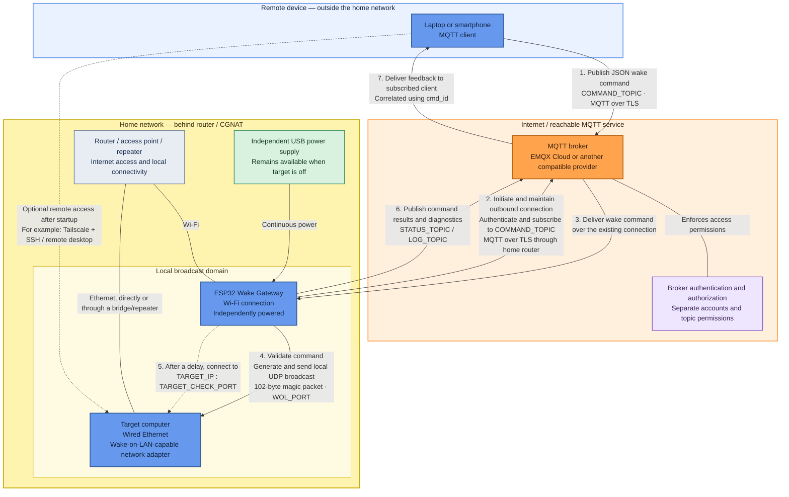

# ESP32 Remote Wake Gateway

A small ESP32 that lets you wake a computer remotely using Wake-on-LAN
(WoL) and MQTT.

The ESP32 stays powered on, connects to an MQTT broker over TLS, and
sends a Wake-on-LAN magic packet to a computer on the same local
network. It can also publish status messages so you can see which step
of the process was reached.

> **Project status:** Work in progress. Test
> results and measured reliability will be added as testing continues.

## Why build this?

I wanted to start my home computer remotely without leaving it running
all day. My home internet connection is behind carrier-grade NAT
(CGNAT), so ordinary inbound IPv4 port forwarding is not a suitable way
to reach the home network.

Instead, the ESP32 makes an **outbound** connection to an MQTT broker
that can be reached from outside the home. A remote device publishes a
wake command to the broker, and the ESP32 receives it over its existing
connection.

This means the wake command does not require a dedicated public IPv4
address at home or inbound router port forwarding. The home router,
internet connection, ESP32, and MQTT broker still need to be available.

## How it works




### Connection model

The remote MQTT client and the ESP32 each establish their own connection
to the broker.

The ESP32 initiates its connection from inside the home network.
The broker delivers wake commands over that existing connection; it does
not need to initiate a new inbound connection through the home router.

This avoids requiring inbound IPv4 port forwarding for the wake workflow.

The broker, ESP32, power supply, and network infrastructure must remain
available while the target computer is shut down.

The target computer is not required to run an MQTT client.

### Local wake-up

The firmware derives the local subnet broadcast address from the ESP32's current Wi-Fi configuration using `WiFi.broadcastIP()` and sends the Wake-on-LAN magic packet over UDP to `WOL_PORT` (default: 9).

The ESP32 and target network adapter must share the broadcast domain used for this transmission. Client isolation, VLAN separation, or broadcast filtering can prevent delivery even when both devices have internet access.

### Feedback and verification

The ESP32 publishes command results to `STATUS_TOPIC` and diagnostic
events to `LOG_TOPIC`.

The remote MQTT client subscribes to those topics to receive feedback.

A command ID associates the received command with its status events.

The TCP verification check targets a configured service, not the
computer's hardware power state.

### Separate remote-access path

Tailscale or another remote-access solution can be used after the target
computer starts.

This is separate from the MQTT wake workflow. The wake command does not
need a VPN connection when both MQTT clients can reach the broker.

The diagram shows the logical remote-access path, not a guarantee of a
direct peer-to-peer connection.

1.  A laptop, phone, or other MQTT client publishes a wake command.
2.  The MQTT broker forwards the command to the ESP32.
3.  The ESP32 sends a Wake-on-LAN magic packet on the local network.
4.  The firmware can check whether a configured TCP service on the
    target computer becomes reachable.
5.  Status and diagnostic messages can be published through MQTT.

**Important:** Sending a packet is not proof that the computer received
it or started. A reachability check confirms that a configured service
responds; it does not prove that this specific command caused the
computer to start.

## Main features

-   Remote Wake-on-LAN through MQTT
-   MQTT over TLS with root-CA certificate validation
-   JSON commands with command IDs
-   Structured status and diagnostic messages
-   Repeated magic-packet transmission
-   Optional TCP service reachability check after wake-up
-   Wi-Fi signal strength, uptime, firmware version, and MQTT connection
    telemetry
-   Reconnection and MQTT re-subscription logic

Feature availability depends on the firmware version. See the
limitations section before relying on any particular behaviour.

## What you need

-   An ESP32 development board with Wi-Fi
-   A USB power supply that remains on when the target computer is shut
    down
-   A target computer with Wake-on-LAN support, preferably connected by
    Ethernet
-   A reachable MQTT broker that supports TLS and compatible
    authentication
-   A laptop or phone with an MQTT client for sending commands and
    viewing status
-   Arduino IDE with ESP32 board support

The ESP32 and target computer must be able to communicate on the local
network. The router/access point and MQTT broker must remain available
while the target computer is off.

## Getting started

The firmware configuration is specific to your network and MQTT
provider. Do not copy example values unchanged and expect them to work.

1.  Install the Arduino IDE and the ESP32 board support package.
2.  Install the `PubSubClient` and `ArduinoJson` libraries.
3.  Copy `secrets.example.h` to `secrets.h`.
4.  Add your Wi-Fi credentials and MQTT broker settings to `secrets.h`.
5. Configure the target computer's MAC address, target name, local IP address, and TCP verification port in `secrets.h`.
6. Add the root CA certificate required to validate the MQTT broker's TLS certificate.
7. Review the timing and retry settings in `config.h`.
8. Ensure the ESP32 can reach an NTP server. The firmware synchronizes its clock using SNTP before attempting the MQTT TLS connection.
9. Build the firmware and flash it to the ESP32.
10. Use an MQTT client to subscribe to the configured status and log topics.
11. Publish a wake command to the configured command topic.

Before testing the full remote workflow, confirm that Wake-on-LAN works
locally and that the target computer's BIOS/UEFI, operating system, and
network adapter allow wake-up from the power state you intend to use.

### Configuration files

``` text
esp32_remote_wake_gateway/
├── esp32_remote_wake_gateway.ino
├── config.h
├── secrets.example.h
├── secrets.h
├── .gitignore
├── README.md
└── LICENSE
```

  ---------------------------------------------------------------------------------
  File                              Purpose                 Commit to Git?
  --------------------------------- ----------------------- -----------------------
  `esp32_remote_wake_gateway.ino`   Main firmware           Yes

  `config.h`                        General settings and    Yes
                                    timing                  

  `secrets.example.h`               Safe example            Yes
                                    configuration           

  `secrets.h`                       Real credentials and    **No**
                                    personal network        
                                    settings                
  ---------------------------------------------------------------------------------

Make sure `secrets.h` is listed in `.gitignore`. Never commit real Wi-Fi
passwords, MQTT passwords, private keys, or personal network details. If
a credential is accidentally published, revoke or rotate it; deleting it
from the latest commit may not remove it from repository history.

### Example MQTT command

Publish to the topic configured in `COMMAND_TOPIC`. The following topic
and values are examples only:

Topic:

``` text
example/home/esp32/wake
```

Payload:

``` json
{
  "cmd_id": "example-wake-001",
  "action": "WAKE",
  "target": "example-server"
}
```

Use a new `cmd_id` for each new request. The `target` value must match
the configured `TARGET_NAME`. Do not retain wake commands on the broker.

### Understanding status messages

  -----------------------------------------------------------------------
  Status                              Meaning
  ----------------------------------- -----------------------------------
  `RECEIVED`                          The ESP32 received and validated
                                      the command.

  `SENT`                              At least one local UDP send
                                      operation succeeded. This does not
                                      prove the target received the
                                      packet.

  `ONLINE`                            The configured TCP service was
                                      reachable during the verification
                                      window.

  `TIMEOUT`                           The service was not detected before
                                      the deadline. The computer might
                                      still have started.

  `FAILED`                            The wake process could not
                                      continue.

  `DUPLICATE_COMMAND`                 The firmware identified a duplicate
                                      within its current detection scope.

  `INVALID_PAYLOAD`                   The command could not be parsed or
                                      did not pass validation.

  `INVALID_TARGET`                    The requested target did not match
                                      the configured target.
  -----------------------------------------------------------------------

A typical flow may look like `RECEIVED → SENT → ONLINE` or
`RECEIVED → SENT → TIMEOUT`. These are possible message sequences, not
test results or guarantees.

For the TCP verification port, choose a service that is already enabled
and expected to be reachable after startup---for example SSH, Remote
Desktop, HTTPS, or a Proxmox web interface. Do not expose a service to
the internet just to make the check pass.

## MQTT access and security

Use separate MQTT credentials for the ESP32 and the remote client, with only the topic permissions each needs.

| Client | Required permissions |
|---|---|
| ESP32 | Subscribe to the command topic; publish to the status, log, and availability topics |
| Remote MQTT client | Publish to the command topic; subscribe to the status, log, and availability topics |

The ESP32 uses QoS 1 when subscribing to the command topic. Outgoing status, log, and availability messages use QoS 0 through `PubSubClient`. The firmware also publishes retained status and availability messages; wake commands should not be retained.

Use the actual topic names configured in `secrets.h`. Keep permissions narrow, retain TLS certificate validation, and avoid anonymous broker access.

## Testing and results

**Measured results will be added here after testing.** No reliability,
latency, power-consumption, or energy-saving figures are claimed yet.

Planned checks include:

-   Local Wake-on-LAN before testing MQTT
-   Remote wake command through the broker
-   Status messages for successful and unsuccessful attempts


When results are available, record the test setup, number of attempts,
successes/failures, measured timings, and any limitations. Keep observed
results separate from expected behaviour.

## Known limitations

- MQTT reconnection and other network operations may still affect responsiveness.
- Duplicate-command protection is limited to the firmware's current in-memory state and does not persist across restarts.
- A single additional command can be queued while a wake process is running. Further commands may be rejected, and command handling has not yet been validated under sustained load.
- The TCP reachability check verifies a configured service, not the computer's physical power state. `TIMEOUT` means the service was not detected before the deadline; it does not identify the root cause.


## Remote access is separate

Wake-on-LAN only asks the computer to start. It does not establish an
SSH, remote desktop, or VPN session. After the computer is running, a
separate solution such as Tailscale may be used to access it remotely.

## Roadmap

-   [ ] Publish the repository and improve setup instructions
-   [ ] Add reproducible firmware build instructions
-   [ ] Record real test results
-   [ ] Measure power consumption before making energy-saving claims
-   [ ] Improve handling of overlapping commands and reconnect behaviour
-   [ ] Add example MQTT client configuration

## Contributing and feedback

Issues, suggestions, and reproducible bug reports are welcome. When
reporting a problem, include the firmware version, ESP32 board, broker
type, relevant redacted logs, and the target computer's power state.
**Never post passwords, tokens, private keys, or unredacted personal
network details.**

## License

Add the license you intend to use before accepting contributions or
presenting the project as open source.
